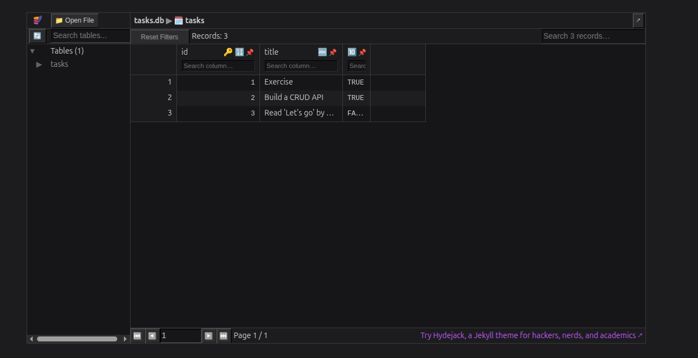
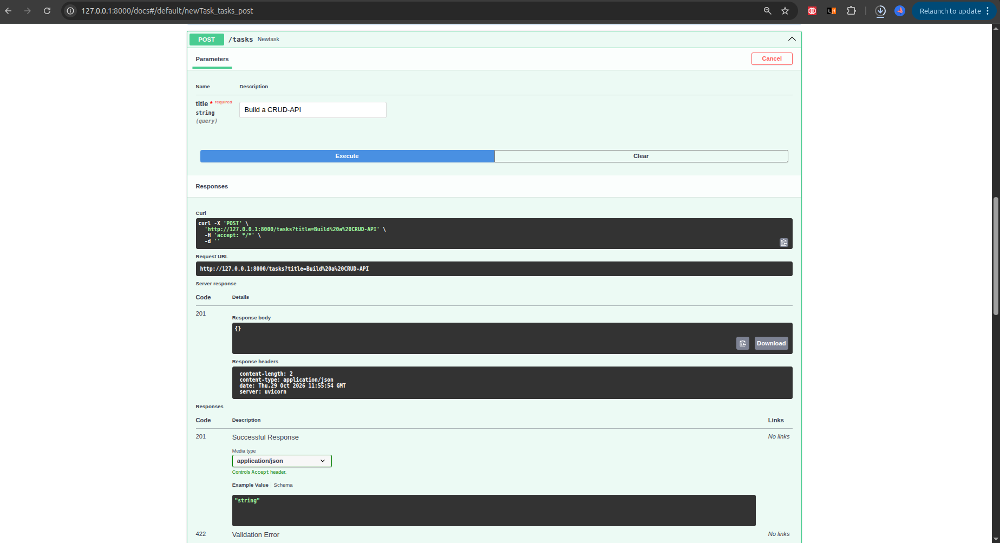
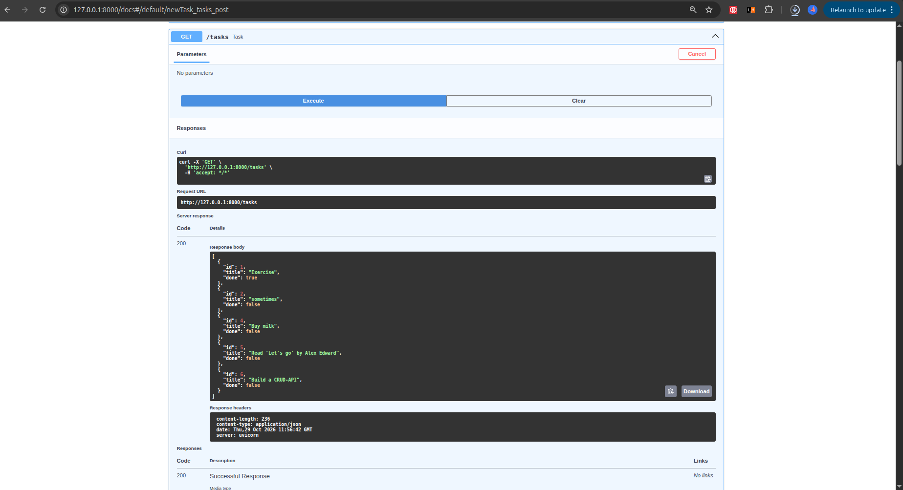
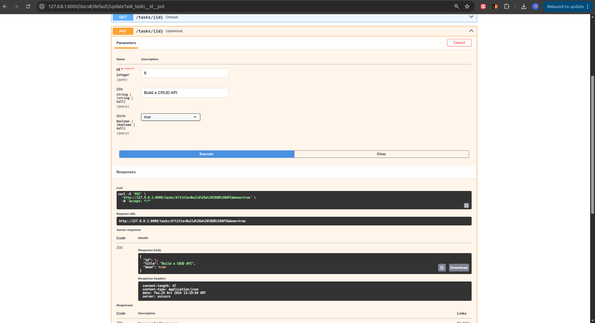
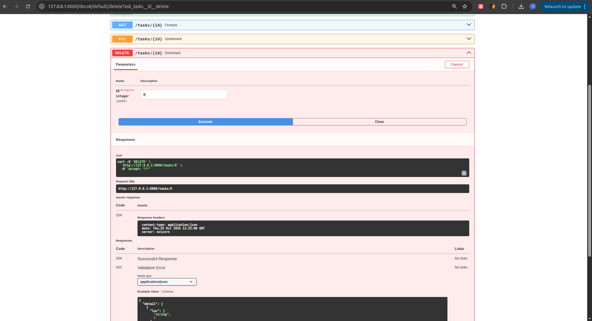

# Task Flow API

A small to-do list API built with FastAPI for FlyRank assignments BE-01 and BE-02. You can create, read, update and delete tasks (full CRUD), and try everything out in Swagger UI.

Tasks are stored in a SQLite database file, `tasks.db`, in the project folder. I used `task.json` to store tasks in BE-01 and since BE-02 is mainly for connecting the CRUD-API to a real database, I migrated.

## Install & run

You need Python 3.10+ and [uv](https://docs.astral.sh/uv/).

```bash
git clone https://github.com/dahmeezy/flyrank-ai
cd flyrank-ai/CRUD_API/my_crudAPI
uv sync
uv run fastapi dev main.py
```

The API runs at http://127.0.0.1:8000 and the Swagger docs are at http://127.0.0.1:8000/docs.

## Why SQLite

- The assignment asked for it, and it's a good first database to learn on.
- It comes built into Python (the `sqlite3` module), so there's nothing extra to install or run.
- The whole database is one file, so there's no database server to set up.
- I can open the file and see exactly what my code did to it.

The tradeoff: it's not built for lots of people writing at once, so a bigger app would move to something like PostgreSQL. For a to-do API on one machine, SQLite is plenty.

## Where the database file lives

The database is a file called `tasks.db` in the project folder, next to `main.py`. It's created automatically the first time the app starts. On startup the app:

1. creates the `tasks` table if it doesn't exist (`id`, `title`, `done`)
2. inserts three example tasks, only if the table is empty

So restarting the server never duplicates the examples. To start fresh, stop the server and delete `tasks.db`. `tasks.db` is local data, so it's listed in `.gitignore` and not committed.

## Endpoints

| Method | Path | What it does | Success | Errors |
|--------|------|--------------|---------|--------|
| GET | `/` | API name, version and endpoints | 200 | |
| GET | `/health` | Check the server is alive | 200 | |
| GET | `/tasks` | List all tasks. Optional filters: `?done=true`, `?search=milk` (they can be combined) | 200 | |
| GET | `/tasks/{id}` | Get one task | 200 | 404 unknown id |
| GET | `/stats` | Gives a stat of recorded tasks | 200 | |
| POST | `/tasks` | Create a task (`{"title": "Buy milk"}`) | 201 | 400 missing or empty title |
| POST | `/reset` | Restores the seed tasks | 200 | |
| PUT | `/tasks/{id}` | Update a task's `title` and/or `done` | 200 | 400 empty body or blank title, 404 unknown id |
| DELETE | `/tasks/{id}` | Delete a task | 204 (empty body) | 404 unknown id |

A task looks like this:

```json
{ "id": 1, "title": "Buy milk", "done": false }
```

## Example request

```bash
curl -i http://127.0.0.1:8000/tasks/1
```

```
HTTP/1.1 200 OK
date: Thu, 29 Oct 2026 14:31:05 GMT
server: uvicorn
content-length: 39
content-type: application/json

{"id":1,"title":"Exercise","done":true}
```

## The database

I checked the data straight from the database file, not through the API, with the `sqlite3` command-line tool:

```bash
sqlite3 tasks.db "SELECT * FROM tasks;"
```

Output after the first startup (the three example tasks):

```
1|Exercise|1
2|Build a CRUD API|1
3|Read 'Let's go' by Alex Edward|0
```

SQLite has no true/false type, so `done` is stored as `1` (done) or `0` (not done). The API converts it back to `true`/`false` in its responses.

Screenshot of the `tasks` table in my database viewer:



## Swagger UI

All five task endpoints show up at `/docs`, and "Try it out" works for the full CRUD cycle.

**Create**



**Read**



**Update**



**Delete**



---

## BE-01 notes (the first version, with a JSON file instead of a database)

#### Observation

I got all the tasks from before after restarting the server. The server has a persistent storage. I used a JSON file as it database and it gets loaded before any of the handlers handles any route.


### AI vs me

#### my prompt

I need you to build a CRUD API for recording tasks in python using fastapi,  with endpoints :get /, post /tasks, post /tasks/:id f no task has that id, return status 404 with a JSON error: `{ "error": "Task 99 not found" } `, put /tasks/:id Returns the updated task. Unknown id → `404` . Empty/invalid body → `400`, delete /tasks/:id Return status 204 ("No Content" — success, nothing to say) with an empty body. Unknown id → `404` . make it so that the swagger UI clearly describes the endpoints that were built.


- Claude's description of the endpoints on swagger UI is cleaner. It handled errors and status code different than I thought. It does not persist and i idont understand its version.

- It silently ignores the json error that i specified for it to output when a task that someone is trying to retrieve does not exist.

- I forgot to specify that it should do it in the simplest/basic way. I think it assumed I'm already good at this and did it the standard way.